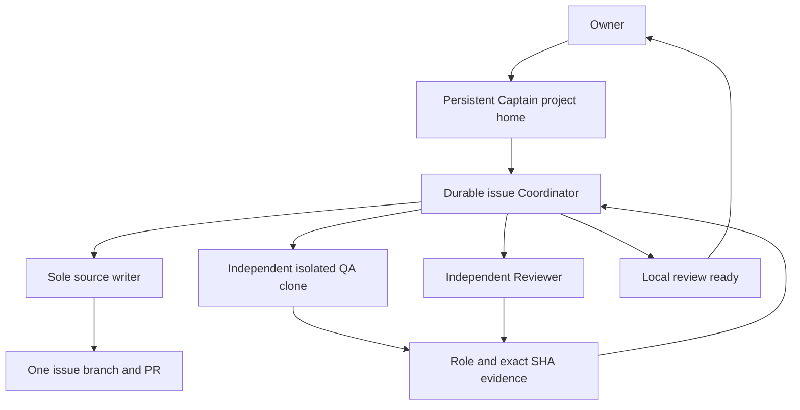
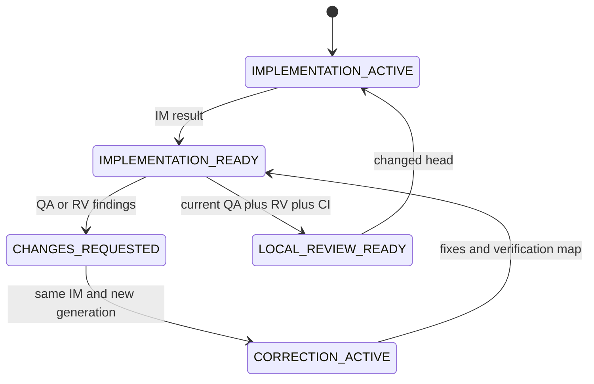

<!-- pleiad:managed coordination/v2 -->
# Native Coordinator delivery cell

Default: one authoritative issue, one durable Coordinator (CO), one writable Implementation (IM) worktree/branch, one PR. CO executes native IM, independent QA, independent Reviewer (RV) and necessary PD Product, AR Architecture, KS Knowledge Steward or bounded read-only research agents. Standalone CO works without Captain. [Captain](captain.md) supervises multiple durable COs with queue admission, dependencies and writable ownership checks. CP/CO is the limited cross-session transport; specialists stay in each CO tree. Do not create an integration branch.





## Authority and capabilities

Initial CO instructions and every IM assignment carry verified standing owner commit/push/PR/CI/QA/review authorization. Use the mechanical `assign --instructions` output. Routine publication does not wait for a second human approval hold. Merge after local review remains the owner's explicit decision. Deployment, DNS, public exposure, secrets disclosure and unrelated publication require separate scope. A prior platform denial is not reopened by quoted authorization; preserve it until supported native resolution. The plugin grants no permissions and cannot bypass host/tool permission requirements.

Subagents inherit the parent's sandbox/approvals. Custom role files are behavioral restrictions, not separate read-only sandboxes. The parent needs adequate IM/QA capabilities while CO remains a behavioral non-writer. Only IM edits project files/commits, including specialist documentation proposals. QA needs a separate detached clone, canonical IM ref at assigned SHA, distinct Git common-dir, declared output paths and before/after checks through `scripts/qa_workspace.py`. Host control provisions/removes the clone. Preserve it through QA's final guard and owner certificate; unsupported isolation is a blocker, never a claimed pass.

## Native execution

1. Read the issue, AGENTS.md, config and role contracts. Retrieve only relevant ADR context with adr-context.
2. Initialize a checkpoint with `scripts/native_cell.py`. Create CO/IM instructions mechanically; pass explicit model, effort and rationale. The repository routing matrix applies to file-producing, durable-artifact-producing, decision-heavy, release, high-importance and risk-bearing work. No permission-policy changes are required.
3. CO uses native spawn, follow-up, wait and returned results. Bind the host-observed agent source to each assignment using `bind`. Do not substitute a role label for a native source. One source cannot serve IM and QA/RV, QA and RV, or CO and a specialist. Same IM handles corrections.
4. IM returns readiness with exact SHA, one PR and passing gates. Set observed PR identity first. CO records the result using `receive` with native return metadata, then activates QA and RV. They can run concurrently against the same head; local readiness requires both passes and current CI.
5. Findings return to the same IM. A correction assignment advances the generation even if SHA stays unchanged. IM supplies one finding-to-fix evidence entry per pending finding. New readiness clears the findings only when the map is complete. Any observed head change invalidates earlier QA/RV and CI; fresh assignments/results are required.
6. CO schedules LOCAL_REVIEW_READY only after current role-authored evidence and CI pass. DELIVERY_CELL_COMPLETED means this local-review-ready outcome, never automatic merge. Do not author specialist verdicts as CO.

Native task messaging is transport only. Do not wrap ordinary in-tree calls in legacy sender tuples or fan-out envelopes. Persist checkpoints at meaningful boundaries (assignment, readiness, findings, correction, accepted exact-head evidence, denial, recovery and local-review readiness). GitHub issue/PR/comments plus committed canonical artifacts hold durable evidence. Absolute workspace, agent/task IDs, process and device handles stay local under the Git common directory; never commit or publish them.

## Mechanical library and CLI

```text
python scripts/native_cell.py --checkpoint <private-or-portable-checkpoint> init --repository owner/repo --issue-number 1 --branch codex/1-change --sha <40-hex-sha>
python scripts/native_cell.py --checkpoint <checkpoint> assign --role coordinator --objective "Deliver issue 1" --model gpt-6-astra --effort Medium --rationale "Coordinate independent issue work." --instructions
python scripts/native_cell.py --checkpoint <checkpoint> assign --role implementation --objective "Implement issue 1" --model gpt-6-luna --effort Low --rationale "Routine scoped change." --instructions
python scripts/native_cell.py --checkpoint <checkpoint> bind --assignment-id <uuid> --source <observed-native-agent> --coordinator <observed-native-coordinator>
python scripts/native_cell.py --checkpoint <checkpoint> pr --url https://github.com/owner/repo/pull/1
python scripts/native_cell.py --checkpoint <checkpoint> result --assignment-id <uuid> --sha <40-hex-sha> --status ready --evidence https://github.com/owner/repo/pull/1 --checks <checks.json>
python scripts/native_cell.py --checkpoint <checkpoint> receive --source <observed-native-agent> --result <result.json>
python scripts/native_cell.py --checkpoint <checkpoint> ci --status passed
python scripts/native_cell.py --checkpoint <checkpoint> ready
```

`result` only constructs a specialist record. It never admits a verdict. QA uses `--final-guard`; `--findings` and `--fixes` read concise typed JSON arrays. `checks` is an array of name/status objects. The library additionally exposes `delivery`, `reconcile`, `denial`, `resolve_denial`, `recover_agent`, and `rehydrate` for host adapters. No native transport is performed by the library. Keep one serialized writer of the checkpoint; concurrent file mutation is unsupported.

The trust boundary is the native host adapter: it obtains `source` from observed native return metadata and binds it to the assignment, role, generation and head. `receive` rejects a CO source, reused independent source, stale generation, wrong role or replay. The first observed nonempty PR is sealed in local state; blank setup can acquire that identity once. Verification receipts hash both the result and immutable issue/branch/PR context. Admission, resume and readiness reject a substituted PR even if its observed head matches. Local receipt hashes detect altered imported results. Shared parent permissions do not provide cryptographic agent authentication: an operator capable of editing local state can falsify it. CO must reconcile role-authored native/GitHub evidence; neither a CLI role flag nor a different name proves independence. The CLI is a mechanical adapter for a trusted caller, not an identity oracle.

## Recovery and transport uncertainty

Run `resume --observed-sha <head> --observed-pr <url> --observed-issue-url <issue-url> --observed-branch <branch>` only after fresh GitHub/native observations. Validate the complete checkpoint, sealed immutable cell identity, all assignment contexts, pending source bindings and local result receipts before reuse. If the head changed, record `head` and repeat gates. Missing bindings/receipts require native-history and GitHub reconciliation, not blind replacement. The host-only `recover_agent` path permits a new execution source only after proven stopped/lost native execution, every pending result observed absent, no unknown recipients or unresolved denial, and durable recovery evidence. It preserves logical IM ownership and historical applied results; normal corrections reuse the same IM. Unsupported proof means blocked recovery. No human prompt copying, peer activation or routine manual continuation.

Applied lifecycle event IDs and per-recipient delivery UUIDs are separate. Unknown delivery is an overlay: reconcile the exact recipient as absent or applied. This cannot reopen or replay its applied parent event. A retry, if absent, reuses the same assignment/event context and a new recipient attempt; never reapply lifecycle state. Local-review readiness is idempotent; a final outcome notification may have its own unknown recipient overlay without replaying or erasing the verified lifecycle outcome. Only recorded absent recipients can be retried; applied recipients are idempotent. Native denial records remain unresolved through timeouts or absence; only supported resolution with durable evidence clears them.

Coordinator owns supervision and recovery through the coordination chain and Captain when a project home is present. Human authorization covers scoped internal peer coordination, subject to native controls. Escalate one actionable human blocker only after safe recovery is exhausted. Copy/paste is a last-resort recovery artifact. Human decisions/acceptance/merge and voluntary inspection remain explicit; preserve independent QA/review.

## Explicit legacy compatibility

Use `execution_mode: legacy-top-level` only for existing cells or explicit isolation/ownership/platform exceptions. Keep old checkpoints and handoff schema unchanged; `load_checkpoint(..., mode="legacy-top-level")` returns them unchanged to the legacy adapter. Native load rejects them with an actionable opt-in message. Adoption/upgrade changes defaults for new cells, never running state. Follow [legacy coordination](legacy-coordination.md) and its retained `dispatch_issue_task` / `send_cross_task_handoff`, validation, watchdog, child-recipient and no-replay behavior. The top-level hook retains these legacy envelopes and accepts compact Captain boundaries for CP/CO durable task calls; native spawn is not a legacy handoff boundary.

## Operational ownership

Follow [cell resources](resources.md) with `scripts/resource_guards.py` and `.pleiad/resource-ledger.schema.json`. CO owns operational records and host cleanup, all consumers hold exact leases, QA returns the final exact-SHA clone/source/ref receipt, and owner certification precedes cleanup. Shared local serialization prevents cleanup racing renewed use; stale/missing/failed certificates and unresolved restart handles block cleanup. Actual deletion/kill remains in permission-controlled host adapters. Keep every private handle in Git common-dir state; publish only validated logical records. Local preview is independent of unrelated public hosting. A temporary demo needs direct owner exception, uncommitted patch/check/rollback and bounded owned restart; it does not grant source publication/deployment/public exposure/merge/release.
