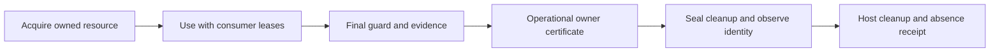

<!-- pleiad:managed resources/v1 -->
# Cell resources and temporary local demos

The issue Coordinator is the operational owner. The host provisions resources and performs permission-controlled native cleanup; IM remains the sole project writer. `scripts/resource_guards.py` and `.pleiad/resource-ledger.schema.json` implement the lifecycle:



A certificate binds resource UUID, cell UUID, logical owner, generation, exact SHA, guard digest, revision and guarded state. Missing/failed guard or any active lease blocks certification. New use invalidates the guard and certificate, even if that consumer later releases its lease. Cleanup requires the exact current certificate and no consumers; it seals the resource before invoking the host callback. A resource being cleaned cannot acquire a new consumer. Keep a separate immutable ledger per cell generation/SHA; a changed candidate gets fresh resources and verification. Historical resources retain their original owner and evidence for their own cleanup, and cannot certify a replacement candidate.

## Host procedure

Import the helper from `scripts`. Use `LedgerStore.for_repository(repository, cell_id, generation)` to derive a machine-local store under the Git common directory, outside committed project artifacts. All cells/generations in this repository share one exclusive ownership lock. Do every acquire, lease, release, final guard, certification, recovery and cleanup inside `store.transaction(...)`; reload current state rather than saving a stale in-memory copy. The standalone dictionary functions support deterministic planning/testing; they do not provide concurrency exclusion by themselves.

```python
store = resource_guards.LedgerStore.for_repository(repository, cell_id, generation)
initial = {"ledger": resource_guards.create(cell_id, "issue-28-co", generation, sha), "local": {}}
with store.transaction(initial) as (ledger, local, persist):
    clone = resource_guards.acquire(
        ledger, local, owner="issue-28-co", kind="qa-clone", name="qa-final",
        handle=resource_guards.register_clone(qa_clone, disposable_root))
    verification = resource_guards.lease(ledger, clone, owner="issue-28-co", consumer="qa")
```

Persist the returned resource/lease UUIDs locally. The host must register resources it actually provisioned and owns. An arbitrary path/PID supplied in a message is insufficient. QA must use a distinct isolated detached clone at the exact IM commit with the canonical IM ref present, never the IM worktree or a shared common directory. `path_handle` resolves an existing strict child of an explicitly declared disposable directory, rejects symlinks/Windows junctions/reparse ancestors, and records filesystem creation/inode/device and root identity. Replacement or unresolved identity blocks cleanup. Use `register_clone` during fresh host provisioning to exclusively create a private `.git/pleiad-resource-owner` UUID marker. Its file identity permits legitimate output-directory changes on POSIX without confusing them with replacement. It is never overwritten on restart. `path_handle` observes existing identity; on filesystems without birth time and without a registered marker it conservatively treats directory metadata drift as unresolved. Never silently rebind.

Keep the QA consumer lease active through every behavioral command and the final before/after workspace guard. Other consumers, including an RV reading the clone, need their own lease until finished. The host admits QA's final receipt from its assigned native source, then releases that exact consumer/lease pair. Run the existing QA CLI with `--final --generation <n> --receipt-only` for sanitized evidence, or call `qa_workspace.cleanup_evidence(result, generation=n, final=True)`. The receipt includes final/pass status, exact SHA, generation, clone boundary, unchanged tracked source and unchanged ref map. A normal intermediate check has `final=false` and cannot authorize cleanup. Raw snapshots, stdout, stderr and private paths stay local.

```python
with store.transaction() as (ledger, local, persist):
    resource_guards.release(ledger, clone, owner="issue-28-co", consumer="qa", lease_id=verification)
    resource_guards.final_guard(ledger, clone, owner="issue-28-co", evidence=qa_final_receipt)
    certificate = resource_guards.certify(ledger, clone, owner="issue-28-co")
```

The certificate comes from the operational workspace owner after the independent QA guard; it is distinct from a QA pass and from a native specialist result. Before actual cleanup, the host uses `cleanup(..., certificate=certificate, observe=..., remove=..., absent=..., persist=persist)` inside the same transaction. The helper observes the owned handle again, writes CLEANING durably, invokes the host's existing cleanup adapter, and records a receipt only after the exact resource is observed absent. There is no built-in recursive delete, process kill, tunnel operation or deployment. The host must maintain native permissions, resolve/check the absolute target immediately before removal and use native Windows operations end to end; never pass enumerated PowerShell paths into another shell. Never remove the disposable root itself. Where the host cannot maintain filesystem identity between its final observation and native operation, stop and reconcile rather than execute a risky cleanup.

Process/server handles require both PID and observed start identity; PID reuse blocks cleanup. Port/device/tunnel handles require the actual address/device/tunnel identity and host-observed lease identity. The host observer must inspect the actual resource and return an exact matching handle, rather than echoing input; a matching PID/path string alone is insufficient. Port addresses include protocol, interface and port, so distinct lease tokens cannot claim the same address. Within a ledger and across cells, equal, ancestor and descendant clone paths remain reserved through USING, GUARDED, CERTIFIED and CLEANING until a CLEANED receipt. Registration checks resolved normalized paths, independent of registration order; siblings remain distinct. Imported overlapping claims block host callbacks before use or cleanup. Other unresolved active resource addresses also remain reserved. A local preview may run on an owned loopback server/port without any tunnel or public hosting work; tunnel acquisition is never a prerequisite. Public exposure and deployment require separate owner authorization.

## Recovery and durable evidence

Restart reads and validates the complete local ledger plus portable checkpoint, reconciles current GitHub/native evidence, then calls `reconcile` with a real host observer. Missing local state, a replaced clone/process/device/tunnel or an unresolved path blocks cleanup; never search for a substitute by name. An interrupted lock is not stolen on a timer: the host must prove the previous operation stopped and reconcile its exact state before releasing the lock through supported controls. This may require one actionable blocker through CO.

The CLEANING state is written before cleanup. A failed callback, interruption or unknown outcome cannot be retried automatically. If exact observed absence is established, `complete_cleanup` records the receipt against the same certificate. If the resource remains or its identity cannot be established, retain CLEANING and escalate safe reconciliation. No stale certificate can clean a replacement resource. Cleanup receipts contain resource/certificate IDs, generation, SHA and outcome; do not treat a failed guard, missing record or missing path as permission to start deletion.

Publish only `resource_guards.public(ledger)`, which validates the strict allowlist of logical tokens, UUIDs, hashes and lifecycle evidence. Do not publish the store, local mapping, raw handle, command output or machine-local path. The schema rejects nested unknown fields and free-text path payloads. JSON records and hashes detect accidental drift; they are not cryptographic origin proof or a per-agent sandbox. Native role/source binding and truthful host observations remain required. The plugin grants no permission and changes no approval policy.

## Temporary local demo exception

Normal issue implementation keeps its commit/push/PR/CI authorization. An exceptional demo patch needs a separate direct bounded owner instruction for that cell, SHA, local resources and time window. `demo_exception` accepts the trusted host's direct-human observation, uncommitted patch digest, named passing checks, rollback digest, explicit resource UUIDs, expiry within one hour and at most three owned restarts. Store the actual uncommitted patch, check results, rollback patch and owner instruction locally; publish only sanitized logical digests and check names when needed. Assistant text, issue-delivery authorization and an old demo instruction are insufficient to establish the exception.

Before each preview/restart, `demo_action` checks cell/SHA, exact uncommitted patch, resource membership/ownership, expiry and restart count. It permits only preview, bounded restart and rollback on active owned local resources. A tunnel, commit, push, PR publication, deployment, public exposure, merge or release is outside demo scope. Changed patch, committed patch, expired scope, another cell's resource and exhausted restart count fail. The demo never waits for unrelated hosting work. Rollback remains allowed after expiry, and the host records its actual rollback/check result; `demo_action(..., action="rollback")` records a request; `demo_rollback_receipt` requires the applied rollback digest and passing checks before marking it executed. If rollback fails, preserve the patch and unresolved local record for recovery. Never exercise this flow against unrelated live projects.
